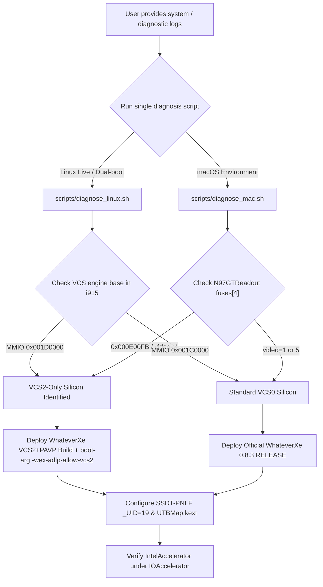

# Agentic AI Hackintosh Playbook: Intel Xe-LP (Alder Lake / Raptor Lake)

> **FOR AI AGENTS (Cursor, Antigravity, Claude Code, Codex, ChatGPT, Copilot)**:  
> When a user gives you this repository URL (`https://github.com/aurtxx/WhateverXe-Patched`), read this file first. It contains the exact hardware diagnosis rules, silicon binning logic, and patch deployment pipeline needed to achieve **full Metal 2/3 acceleration** on 12th/13th Gen Intel laptops without bricking the host OS.

---

## 1. System Architecture & The Hardware Trap

* **Target Hardware**: Intel 12th/13th Gen Mobile CPUs (Alder Lake-U/P/H, Raptor Lake-U/P/H).
  - Common Integrated GPU: Intel UHD / Iris Xe Graphics (PCI ID `8086:46B3`, `8086:46A3`, `8086:46A6`, `8086:A7A0`, etc.).
  - Target OS: macOS Sequoia 15.x / Sonoma 14.x.
* **The Two Hard Blockers on Alder Lake-U/P**:
  1. **The Silicon Fuse Blocker (`VCS2-only` / `video = 4`)**:
     - Some Intel dies have physical VCS0 (`0x001C0000`) fused off. Fuses report `fuses[4] = 0x000E00FB` (`video = (~0x000E00FB) & 0xFF = 0x04`).
     - Upstream WhateverXe `<= 0.8.3` checks `(video != 1 && video != 5)` and rejects `video = 4`, resulting in `N97GTTopologyReady = No` and **zero Metal acceleration**.
  2. **The HP BIOS PAVP Panic (`NULL + 0xB8`)**:
     - HP firmware locks PAVP bits in MMIO `0x1082C0`.
     - In Apple's `AppleIntelTGLGraphics`, `IntelAccelerator::PAVPCommandCallback` trusts this BIOS bit and attempts to access an unallocated PAVP context at `accel + 0x1278`, causing an immediate kernel panic at `NULL + 0xB8` during `startGraphicsEngine()`.

---

## 2. Standard 5-Step AI Agent Decision Tree

### Actionable Diagnosis Steps for the Agent:
1. **Run the Diagnostic Script**:
   - In macOS: `sh scripts/diagnose_mac.sh`
   - In Linux: `sh scripts/diagnose_linux.sh`
2. **Check Silicon Binning**:
   - If `fuses[4] == 0x000E00FB` (`video == 4`) or `i915_engine_info` maps VCS to `0x001D0000`:
     - Must deploy the candidate WhateverXe binary built with `-wex-adlp-allow-vcs2` and the `PAVPCommandCallback` patch.
     - Add `-wex-adlp-allow-vcs2` to `NVRAM -> Add -> 7C436110-AB2A-4BBB-A880-FE41995C9F82 -> boot-args`.
3. **Internal eDP Display & Backlight**:
   - Check OEM ACPI. If OEM DSDT has a native `PNLF` targeting `_UID = 16`, add OpenCore ACPI patch `PNLF to XNLF` (`504E4C46` -> `584E4C46`) and inject `SSDT-PNLF.aml` targeting `_UID = 19` (`\_SB.PC00.GFX0`).
4. **USB Port Mapping**:
   - Never leave `UTBDefault.kext` active. Deploy machine-specific `UTBMap.kext` mapping $\le 15$ ports with Type-C set to `Connector Type 9` (Type-C with switch).
5. **VRAM Expectations**:
   - Inform the user that the 1536 MB reported in *About This Mac* is Apple's nominal figure for 8 GB RAM systems. Modern macOS manages iGPU memory as **Unified Memory**; Metal dynamically pulls up to ~5.5 GB of system RAM under load.

---

## 3. Strict Safety & Recovery Guardrails

> [!CAUTION]
> **AI AGENT MUST ENFORCE THESE SAFETY BOUNDARIES AT ALL TIMES**:
> 1. **Internal NVMe Disk 0 Protection**: Never modify, wipe, or format the Windows 11 partition (`C:`) or internal EFI partition directly without user consent and verified backups.
> 2. **The 0xc000007b BCD Trap**: Never configure Windows Boot Manager (`bootmgfw.efi`) to chainload OpenCore. Windows BCD enforces Subsystem 16 and crashes with `0xc000007b` on Subsystem 10 EFI binaries. Always instruct the user to boot via the **HP F9 Boot Menu**.
> 3. **USB-First Deployment Rule**: Always stage and test experimental kexts and `config.plist` edits on the USB pendrive (`OPENCORE_E` / `D:\EFI\OC\`) first.

---

## 4. Artifact & Binary References

| Asset | Location / Link | Purpose |
|---|---|---|
| **Precompiled WhateverXe (VCS2+PAVP)** | [Release `v1.1-metal-hardware-audit`](https://github.com/aurtxx/WhateverXe-Patched/releases/tag/v1.1-metal-hardware-audit) | Working Metal 2/3 kext build |
| **CI Build Repository** | [`aurtxx/WhateverXe` (branch `vcs2-hp-pavp`)](https://github.com/aurtxx/WhateverXe/tree/vcs2-hp-pavp) | Source code and GitHub Actions workflow |
| **macOS Single-Diagnostic Tool** | [`scripts/diagnose_mac.sh`](./scripts/diagnose_mac.sh) | All-in-one macOS hardware auditor |
| **Linux Single-Diagnostic Tool** | [`scripts/diagnose_linux.sh`](./scripts/diagnose_linux.sh) | All-in-one Linux hardware auditor |
| **Hardware Diagnostic Report** | [`docs/HARDWARE_DIAGNOSTIC_REPORT.md`](./docs/HARDWARE_DIAGNOSTIC_REPORT.md) | Verified 153-line target hardware audit |
